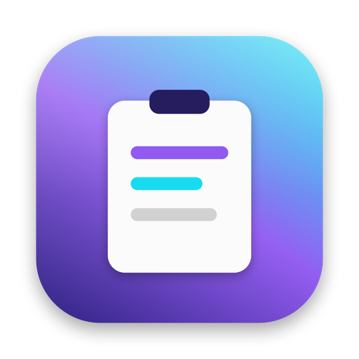
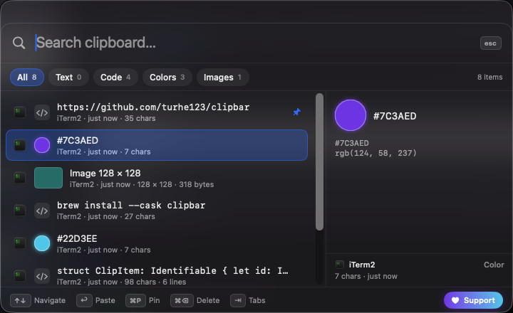

<p align="center">
  
</p>

<h1 align="center">ClipBar</h1>

<p align="center">
  <strong>A blazing-fast, ultra-lightweight clipboard manager for macOS.</strong><br>
  100% native Swift · &lt;30 MB RAM · 500-item history · zero permissions · pay what you want (even $0)
</p>

<p align="center">
  <a href="https://github.com/turhe123/clipbar/releases/latest"></a>
  <a href="https://github.com/turhe123/clipbar/actions/workflows/build.yml"></a>
  <a href="https://github.com/turhe123/clipbar/releases"></a>
  <a href="LICENSE"></a>
  
  
  <a href="https://ko-fi.com/turhe123"></a>
</p>

<p align="center">
  <a href="https://turhe123.github.io/clipbar/"><b>⬇ Download (Pay What You Want)</b></a> ·
  <a href="#build-from-source">Build from source</a> ·
  <a href="https://github.com/turhe123/clipbar/issues">Report a bug</a> ·
  <a href="https://ko-fi.com/turhe123">Support Or (Leo) Davidai ❤️</a>
</p>

---

<p align="center">
  
</p>

**ClipBar** lives in your menu bar and remembers the last 500 things you copied. Press **⌘⇧V** anywhere and a
Spotlight-style glass panel appears over whatever you're doing — even full-screen apps. Type to fuzzy-search,
arrow to the item you want, hit **↩** and it's back on your clipboard (and pasted straight into the app in front
of you, if you let it). No Dock icon, no accounts, no telemetry, no Electron.

> An open-source project by **[Or (Leo) Davidai](https://github.com/turhe123)** — I build fast, lightweight,
> ad-free tools. If ClipBar saves you a few seconds a day, consider [supporting my work ❤️](https://ko-fi.com/turhe123).

## Features

| | |
|---|---|
| ⚡ **Instant** | Native AppKit + SwiftUI panel. Opens in a frame, searches 500 items as you type. |
| 🪶 **Tiny** | ~28 MB physical footprint idle, ~0.1 % CPU. Image pixels never live in RAM — only 120 px thumbnails. |
| 🧠 **Smart classification** | **Text**, **Code** (monospace, detected from IDE/terminal sources or symbol density), **Colors** (`#hex`, `rgb()`, `hsl()` rendered as swatches) and **Images** (SHA-256 deduplicated, stored as PNG). |
| 🔍 **Fuzzy search + filter tabs** | Substring hits rank first, then in-order fuzzy matches. Jump between All / Text / Code / Colors / Images with ⌘1–⌘5 or ⇥. |
| 📌 **Pin what matters** | Pinned items float to the top and never get pruned. |
| 🔁 **Dedupe** | Copy something you already have and it moves to the top instead of duplicating. |
| 🔒 **Privacy first** | Respects `org.nspasteboard.ConcealedType` / `TransientType` / `AutoGeneratedType`, so password managers stay private. Everything stays on disk in `~/Library/Application Support/ClipBar`. |
| 🛡 **Zero permissions** | The global hotkey uses Carbon `RegisterEventHotKey`, which needs no Accessibility access. Auto-paste is opt-in. |
| 🌌 **Everywhere** | Floats over full-screen apps and every Space, opens on the display your mouse is on. |
| 💾 **Durable** | SQLite (WAL) with a 500-item ring buffer; orphaned image blobs are swept on launch. |

## Keyboard shortcuts

| Shortcut | Action |
|---|---|
| **⌘⇧V** | Toggle ClipBar (global) |
| **↑ / ↓** | Move selection (wraps around) |
| **⌘↑ / ⌘↓**, **Page Up / Down** | Jump to first / last item |
| **↩** | Copy selected item and paste into the frontmost app (paste requires Accessibility; otherwise copy only) |
| **⌥↩** | Copy only, never paste |
| **⌘P** | Pin / unpin selected item |
| **⌘⌫** | Delete selected item |
| **⌘1 … ⌘5** | Filter: All · Text · Code · Colors · Images |
| **⇥ / ⇧⇥** | Next / previous filter tab |
| **Esc**, **⌘W**, click outside | Close the panel |
| **Double-click** | Paste that item |

Right-click any row for Paste / Copy only / Pin / Delete.

## Install

1. Download **`ClipBar.zip`** from the [landing page](https://turhe123.github.io/clipbar/) (pay what you want, $0 is fine) or [GitHub Releases](https://github.com/turhe123/clipbar/releases/latest).
2. Unzip and drag **ClipBar.app** to `/Applications`.
3. First launch: the build is ad-hoc signed, not notarized, so **right-click → Open** once (or allow it in *System Settings → Privacy & Security*).
4. ClipBar appears in the menu bar. Press **⌘⇧V**.

Optional, from the menu-bar icon:

- **Launch at Login** — uses `SMAppService`, no helper app.
- **Enable Auto-Paste** — grants Accessibility so **↩** also sends ⌘V to the app you came from. Without it ClipBar just copies.
- **Pause Monitoring** / **Clear Unpinned History…**

## How it works

```
┌──────────────┐  changeCount?  ┌───────────────────┐  classify   ┌──────────────────┐
│ NSPasteboard │ ─────0.4 s────▶│ PasteboardMonitor │ ──────────▶ │  StorageManager  │
└──────────────┘  (bg timer)    │  main-thread read │  text/code  │  SQLite3 (WAL)   │
                                │  privacy markers  │  color/img  │  500-item ring   │
                                └───────────────────┘             └────────┬─────────┘
                                                                           │ image bytes
      ⌘⇧V (Carbon hotkey) ──▶ PanelController ──▶ FloatingPanel ◀── ClipboardViewModel
                                  key routing       NSPanel +            ▲       ImageStore
                                                    NSVisualEffectView   └── thumbnails (ImageIO, ≤120 pt)
```

- **Polling, not hooks.** A `DispatchSourceTimer` on a utility queue compares `NSPasteboard.general.changeCount` every 0.4 s (0.1 s leeway) and returns immediately when nothing changed. Only an actual change touches the pasteboard on the main thread.
- **Memory budget.** Text is stored in SQLite; only the first 8 KB per item is kept in RAM for search. Images are written to `Blobs/` as PNG via `CGImageDestinationAddImageFromSource` (no intermediate bitmap) and thumbnailed with `CGImageSourceCreateThumbnailAtIndex`. Thumbnails sit behind an `NSCache`.
- **Non-activating panel.** `FloatingPanel` is an `NSPanel` with `.nonactivatingPanel`, `level = .floating` and `[.canJoinAllSpaces, .fullScreenAuxiliary]`, so your app stays frontmost while you type into ClipBar — which is what makes auto-paste land in the right window.
- **Keyboard first.** A local `NSEvent` monitor handles navigation before SwiftUI sees the key, so the search field keeps focus while arrows, ⌘P, ⌘⌫ and ⌘1–5 work from anywhere in the panel.

## Build from source

Requires macOS 14+ and the Xcode Command Line Tools (Xcode itself is optional).

```bash
git clone https://github.com/turhe123/clipbar.git
cd clipbar

# Debug build
swift build

# Release app bundle → dist/ClipBar.app + dist/ClipBar.zip (universal, ad-hoc signed)
./scripts/build_app.sh
```

`scripts/build_app.sh` prefers `swift build -c release`; on machines where SwiftPM cannot compile the manifest
(some Command Line Tools installs ship a broken `PackageDescription` module) it falls back to compiling the
sources directly with `swiftc`, builds both architectures and merges them with `lipo`. Set `ARCHS="arm64"` for a
single-architecture build. The app icon is regenerated from `scripts/make_icon.swift` if `Resources/AppIcon.icns`
is missing.

### Project layout

```
Sources/ClipBar/
├── App/        main.swift, AppDelegate, Constants (links, limits, bundle-ID lists)
├── Core/       PasteboardMonitor, ContentClassifier, StorageManager (SQLite), ImageStore,
│               HotKeyManager (Carbon), PasteHelper, FuzzyMatcher, ClipItem
└── UI/         FloatingPanel, PanelController, ClipboardBarView, AboutWindow, StatusBarController
Resources/      Info.plist (LSUIElement), AppIcon.icns
scripts/        build_app.sh, make_icon.swift
docs/           GitHub Pages landing page with the "Pay What You Want" download flow
```

## Support the project

ClipBar is free and MIT-licensed. Builds are offered on a **pay-what-you-want** basis so I can keep making
fast, ad-free, open-source tools — **$0 is a perfectly fine amount.**

<p align="center">
  <a href="https://ko-fi.com/turhe123"></a>
</p>

Other ways to help: ⭐ star the repo, [report bugs](https://github.com/turhe123/clipbar/issues), or send a PR.

## License

[MIT](LICENSE) © 2026 Or (Leo) Davidai
